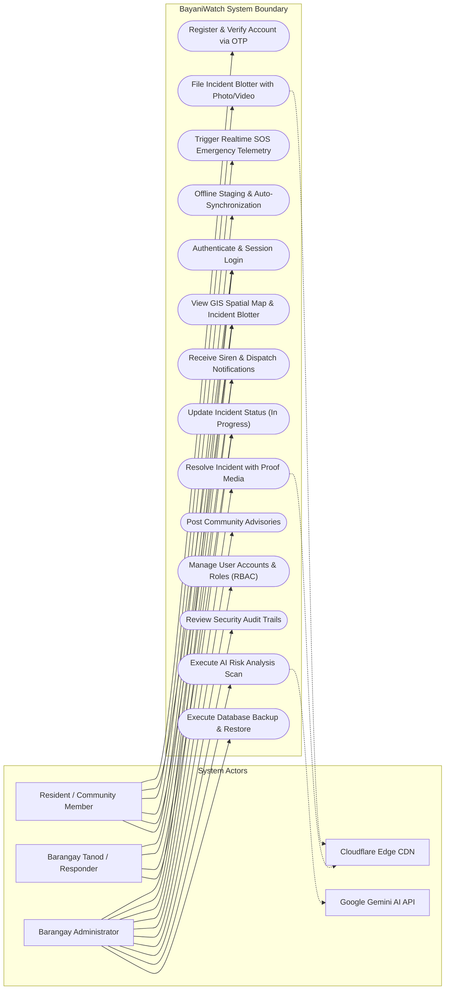
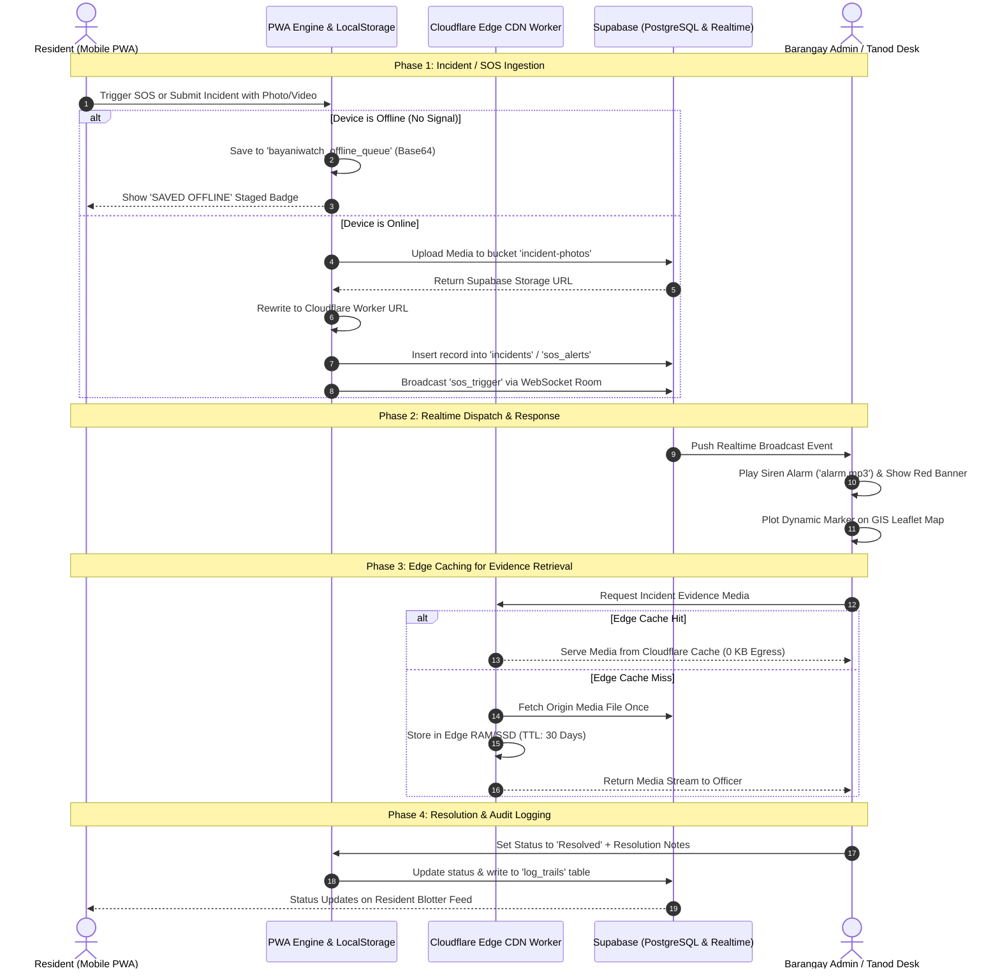
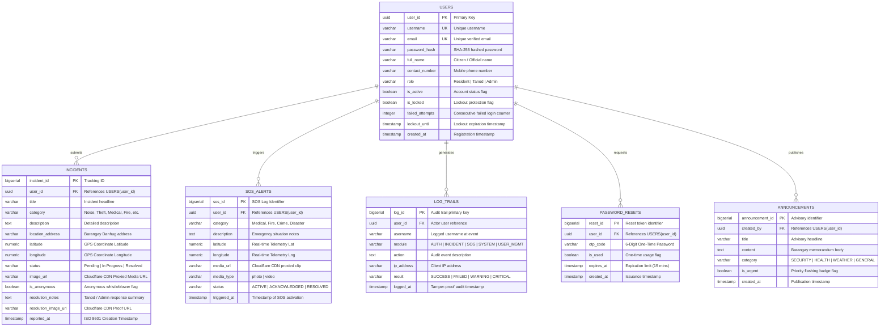
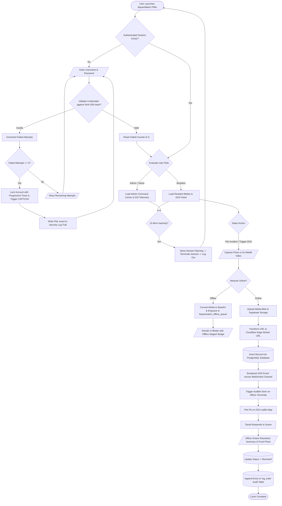
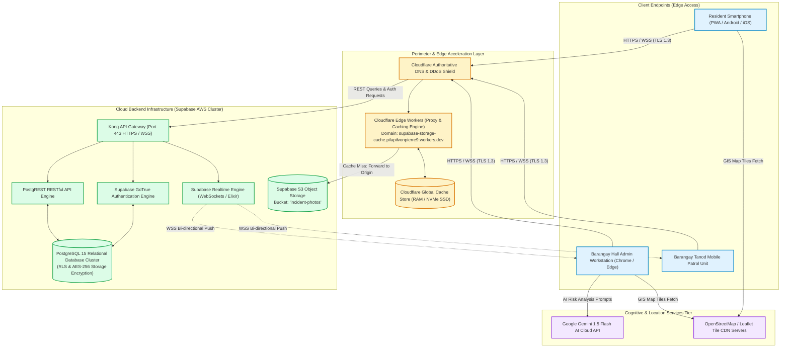

# BayaniWatch: System Integration & Architecture Final Diagrams

**System Title:** BayaniWatch: Barangay Danhug Digital Incident Blotter, Emergency SOS Telemetry & GIS Command System  
**Course:** System Integration and Architecture (SIA) / Information Assurance and Security 1 (IAS1)  

---

## 1. Use Case Diagram (System Users & Functionalities)

---

## 2. System Flow Diagram (Swimlanes & Pools)

---

## 3. Entity Relationship Diagram (ERD)

---

## 4. System Flowchart

---

## 5. Network Diagram (Network Flow)

